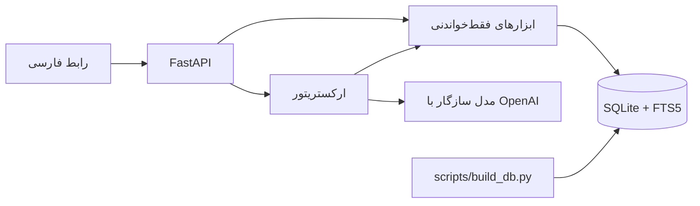

# استارکوچ

دستیار خرید **حضوری** روی خروجی ترب. کاربر کالا را جست‌وجو می‌کند، کارت محصول را می‌بیند، و فروشگاه‌های اطراف را با فاصله و تازگی قیمت مقایسه می‌کند. رابط فارسی، راست‌به‌چپ و موبایل‌اول است.

مدل زبانی حق ندارد محصول، قیمت یا فروشگاه بسازد. اگر کلید مدل تنظیم شده باشد، فقط ابزار را انتخاب می‌کند. جمله‌ای که کاربر می‌بیند از خروجی همان ابزارها ساخته می‌شود.

## داده

سه فایل CSV از بستهٔ Starcoach v16 (حدود ۲۲۵٬۹۰۳ محصول، ۳۳۱٬۵۰۶ پیشنهاد، ۶٬۴۷۶ فروشگاه):

| فایل | کلید | اتصال |
| --- | --- | --- |
| `shops.csv` | `shop_id` | — |
| `products.csv` | `product_id` | — |
| `offers.csv` | `offer_id` | `shop_id` → فروشگاه، `product_id` → محصول |

ستون دیگری به اسکیما اضافه نشده است. فیلدهای `*_norm`، تصویر اصلی، ستون‌های گارانتی و جدول‌های دسته/تماس/پرداخت از همین ستون‌ها استخراج می‌شوند.

قیمت‌های کمتر از ۱۰۰۰ یا بیشتر از `1e11` تومان خالی می‌شوند. شماره‌های تماس این مجموعه **ساختگی (FAKE)** هستند و هیچ تماسی گرفته نمی‌شود.

خودِ داده در گیت نیست. نشانی دانلود فقط در اسکریپت و همین فایل آمده است:

`https://startech.s3.ir-central1.arvanstorage.ir/starcoach-dataset-v16-cap300-csv.zip`

## معماری



- `scripts/build_db.py` فایل زیپ را می‌گیرد، سه CSV را استخراج می‌کند، متن فارسی را یکدست می‌کند و SQLite می‌سازد.
- `backend/app/db` اتصال فقط‌خواندنی.
- `backend/app/tools` شش ابزار.
- `backend/app/agent` انتخاب ابزار و ساخت پاسخ از نتیجه.
- `backend/app/api` مسیرهای کارت‌ها و `/chat`.
- `frontend` جست‌وجو، کارت، فروشگاه، مقایسه و یک ورودی گفتگو.

جست‌وجوی فعلی FTS5 با توکنایزر `unicode61` است و اگر نتیجه کم باشد `trigram` هم صدا زده می‌شود. مسیر بعدی Postgres است: `pg_trgm` به‌جای تریگرم، `pgvector` برای عنوان فارسی به‌همراه برند و مشخصات کلیدی، و `geography` به‌جای هاورساین در پایتون.

## ابزارها

| ابزار | وضعیت |
| --- | --- |
| `search_products` | کار می‌کند. فیلتر برند، دسته و قیمت. |
| `find_stores_for_product` | کار می‌کند. فاصله، مرتب‌سازی، کهنه‌بودن قیمت. |
| `compare_products` | خواندن مشخصات و بازهٔ قیمت. هم‌معنی‌سازی کلیدها و امتیاز تفاوت مانده. |
| `compare_stores` | قیمت، فاصله، تازگی و پرداخت. رتبهٔ وزنی مانده. |
| `check_store_freshness` | سن قیمت از `last_price_changed_at`. آستانهٔ جدا برای هر دسته مانده. |
| `contact_store` | فقط نمایش تماس برای بررسی انسان. شماره‌ها ساختگی‌اند. صف تأیید انسان مانده و شماره‌گیر وصل نمی‌شود. |

آستانهٔ کهنه‌بودن با `STALE_PRICE_DAYS` است و پیش‌فرض ۳۰ روز است.

## راه‌اندازی محلی

Python 3.12 لازم است.

```bash
python3 -m venv .venv
source .venv/bin/activate
pip install -r requirements.txt
cp .env.example .env
python scripts/build_db.py
uvicorn backend.app.main:app --reload --host 0.0.0.0 --port 8000
```

بعد مرورگر را روی `http://127.0.0.1:8000` باز کنید.

اگر CSVها از قبل در `data/csv/` باشند:

```bash
python scripts/build_db.py --skip-download
```

مسیر خروجی را می‌توان عوض کرد:

```bash
python scripts/build_db.py --data-dir ./data --db ./data/starcoach.db
```

اجرای دوباره پایگاه را از نو می‌سازد و فقط بعد از `quick_check` جایگزین می‌کند.

تست‌ها با یک CSV کوچک، بدون دانلود داده:

```bash
python -m unittest discover -s tests -v
```

## متغیرهای محیطی

نمونه در `.env.example` است. مقدار واقعی را commit نکنید.

| نام | نقش |
| --- | --- |
| `BOXAPI_API_KEY` | کلید مدل. اگر خالی باشد گفتگو به جست‌وجوی مستقیم برمی‌گردد. |
| `BOXAPI_BASE_URL` | پایهٔ سازگار با OpenAI، معمولاً با پسوند `/v1`. |
| `BOXAPI_MODEL` | نام مدل. |
| `DATABASE_PATH` | فایل SQLite. |
| `CORS_ORIGINS` | مبدأهای مجاز، یا `*`. |
| `STALE_PRICE_DAYS` | سن کهنه‌بودن قیمت. |
| `DATASET_URL` | فقط برای اسکریپت دانلود. |
| `DATA_DIR` | پوشهٔ ZIP و CSV. |

درخواست مدل به `{BOXAPI_BASE_URL}/chat/completions` می‌رود و ابزارها با tool calling فرستاده می‌شوند.

## استقرار در لیارا

استقرار پیشنهادی یک برنامهٔ داکر است که API و رابط را با هم سرو می‌کند. از ریشهٔ مخزن:

1. در پنل لیارا یک برنامهٔ Docker بسازید. شناسه را در `liara.json` در فیلد `app` بگذارید.
2. متغیرها را در پنل تنظیم کنید، نه در فایل: `BOXAPI_API_KEY`، `BOXAPI_BASE_URL`، `BOXAPI_MODEL`، `DATABASE_PATH=/data/starcoach.db`، `STALE_PRICE_DAYS=30`.
3. `liara deploy` را از ریشه اجرا کنید. پورت برنامه ۸۰۰۰ است و بررسی سلامت به `/health` می‌زند. این مسیر حتی بدون پایگاه هم ۲۰۰ برمی‌گرداند تا استقرار قبل از ساخت داده شکست نخورد.
4. یک دیسک بسازید. CSVها حدود ۲۸۵ مگابایت‌اند و SQLite به‌همراه FTS بزرگ‌تر می‌شود؛ برای شروع ۲ گیگابایت منطقی است. بعد از ساخت دیسک این بلوک را به `liara.json` اضافه کنید و دوباره مستقر کنید. نام دیسک باید همان نام پنل باشد:

```json
"disks": [
  { "name": "starcoach-data", "mountTo": "/data" }
]
```

5. در پوستهٔ برنامه پایگاه را روی دیسک بسازید:

```bash
python scripts/build_db.py --data-dir /data --db /data/starcoach.db
```

داده داخل ایمیج نیست. دیسک موقت لیارا با هر استقرار پاک می‌شود؛ بدون دیسک، پایگاه را بعد از هر deploy از دست می‌دهید.

### فقط API با پلتفرم پایتون

اگر داکر نخواهید، از ریشه با پلتفرم `python` مستقر کنید و دستور اجرا را بگذارید:

```json
{
  "platform": "python",
  "port": 8000,
  "python": { "version": "3.12" },
  "args": ["uvicorn", "backend.app.main:app", "--host", "0.0.0.0", "--port", "8000"]
}
```

### رابط جدا

`frontend/liara.json` برای پلتفرم `static` است. قبل از استقرار، در `frontend/js/config.js` مقدار `window.STARCOACH_API_BASE` را برابر آدرس API بگذارید و `CORS_ORIGINS` را به مبدأ سایت محدود کنید. مسیر پیش‌فرض همان مبدأ است و برای داکر نیازی به تغییر ندارد.

`docker-compose.yml` برای اجرای محلی همین تصویر است. پوشهٔ `./data` روی `/data` سوار می‌شود.

## چه چیزهایی مانده

- امبدینگ چندزبانه و جست‌وجوی ترکیبی با `pgvector`
- انتقال فاصله به `geography` در Postgres
- هم‌تراز کردن کلیدهای هم‌معنی در مقایسهٔ مشخصات
- رتبهٔ وزنی فروشگاه (قیمت، فاصله، تازگی، پرداخت اقساطی)
- آستانهٔ کهنه‌بودن جدا برای هر دسته
- صف بررسی انسانی برای تماس؛ بدون شماره‌گیر
- نشان‌دادن نثر مدل فقط وقتی همهٔ عددهایش در خروجی ابزار باشند

## English

Starcoach is an in-person shopping assistant over a Torob CSV export. A download script builds a local SQLite database with FTS5 (`unicode61` plus trigram). FastAPI exposes search, nearby stores, comparison, price freshness, and a simulated contact lookup. The phone numbers in the dataset are fake; contact is human-in-the-loop and never dials.

The chat route can call an OpenAI-compatible model (`BOXAPI_API_KEY`, `BOXAPI_BASE_URL`, `BOXAPI_MODEL`). The sentence returned to the UI is composed from tool payloads. Without a key, chat falls back to `search_products` and says so. The primary UI is cards, filters, and store lists, not a bare chat box.

Do not commit `data/`, CSV, ZIP, or SQLite files. See `.env.example` and the Liara section above for deploy. Root `liara.json` plus `Dockerfile` is the intended single app. Build the database onto a mounted disk at `/data` after deploy.
